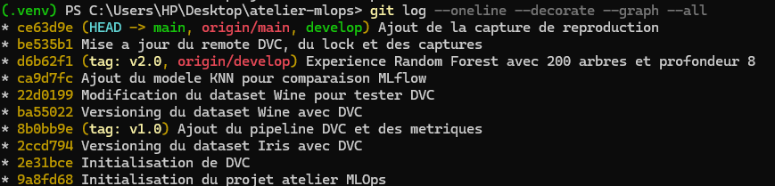
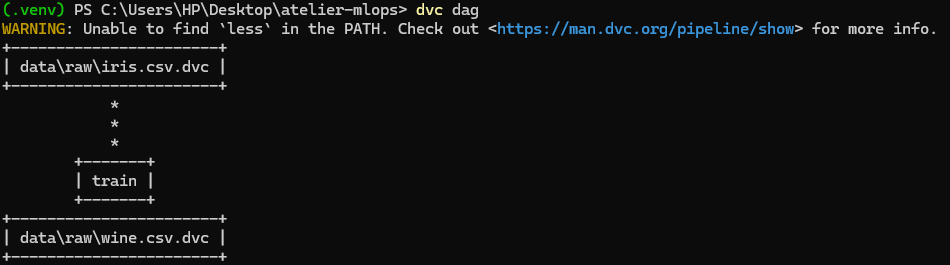
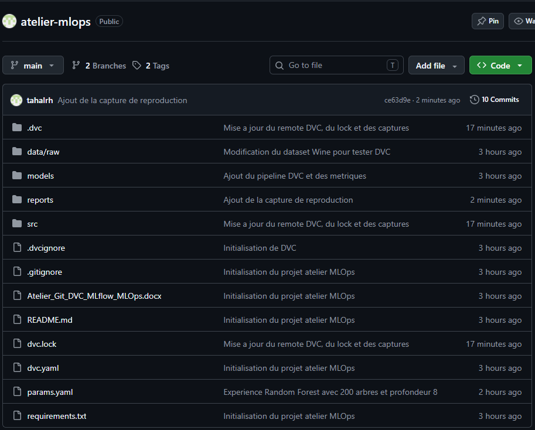

# Rapport : Atelier Git + DVC + MLflow

**Projet :** classification du dataset Iris avec RandomForest et KNN
**Dépôt :** https://github.com/tahalrh/atelier-mlops

## 1. Objectif

Ce rapport présente la mise en place d'un projet de Machine Learning versionné, traçable et reproductible. Trois outils sont utilisés : Git pour le code, DVC pour les données et le pipeline, MLflow pour le suivi des expériences.

Le projet repose sur le dataset Iris et compare un classifieur RandomForest à un classifieur KNN.

## 2. Versionnement du code avec Git

Le dépôt Git contient deux branches, `main` et `develop`, ainsi que deux tags, `v1.0` et `v2.0`. La figure suivante présente l'historique des commits.

L'historique montre les différentes étapes du projet, les branches `main` et `develop`, ainsi que les tags `v1.0` et `v2.0`.

## 3. Versionnement des données avec DVC

DVC prend en charge les fichiers volumineux et la description du pipeline. Les datasets Iris et Wine sont versionnés de cette manière.

Le pipeline contient une étape `train` qui produit le modèle et les métriques à partir du dataset versionné.

## 4. Publication sur GitHub

Le projet est publié sur GitHub. Le dépôt contient le code source, les fichiers DVC, les paramètres et les résultats des expériences.

Le dépôt présente deux branches et deux tags. L'ensemble du projet est accessible depuis cette page.

## 5. Comparaison de deux modèles avec MLflow

MLflow enregistre pour chaque exécution les paramètres, les métriques et le modèle produit. La figure suivante compare un RandomForest à un KNN.

Le KNN obtient une accuracy de 1,0, contre 0,9333 pour le RandomForest de référence.

## 6. Comparaison de trois expériences

Une deuxième expérience fait varier les paramètres du RandomForest. Les trois exécutions sont comparées dans MLflow.

Les résultats sont les suivants : RandomForest avec 100 arbres et une profondeur de 5 obtient 0,9333 ; RandomForest avec 200 arbres et une profondeur de 8 obtient 0,9 ; le KNN avec 5 voisins obtient 1,0. Augmenter le nombre d'arbres et la profondeur ne garantit donc pas une meilleure accuracy.

## 7. Restauration de la version v1.0

Le retour au tag `v1.0` s'effectue avec `git checkout`, suivi de `dvc checkout`. Cette opération restaure les données, le modèle et les métriques de la version initiale.

Les métriques restaurées correspondent à la version de référence, avec une accuracy de 0,93333. Le modèle rechargé prédit correctement la classe `setosa`.

## 8. Reproduction du projet dans un clone

Pour vérifier la reproductibilité, le dépôt a été cloné dans un second dossier. Les données sont récupérées avec `dvc pull`, puis le pipeline est relancé avec `dvc repro --force`.

Les métriques obtenues sont une accuracy de 0,9 et un F1-score de 0,89975. Le projet est donc reproductible à partir du dépôt et du stockage distant.

## 9. Résultats

Le tableau 1 récapitule les performances obtenues pour les trois configurations testées.

**Tableau 1 : Performances des modèles**

| Modèle | Paramètres | Accuracy | F1-score |
|---|---|---:|---:|
| RandomForest | 100 arbres, profondeur 5 | 0,9333 | 0,9333 |
| RandomForest | 200 arbres, profondeur 8 | 0,9 | 0,89975 |
| KNN | 5 voisins | 1,0 | 1,0 |

## 10. Conclusion

Git permet de versionner le code, DVC permet de versionner les données et le pipeline, et MLflow permet de suivre et de comparer les expériences.

La restauration d'une version antérieure et la reproduction du projet dans un clone fonctionnent correctement. Le pipeline est donc traçable, versionné et reproductible.
