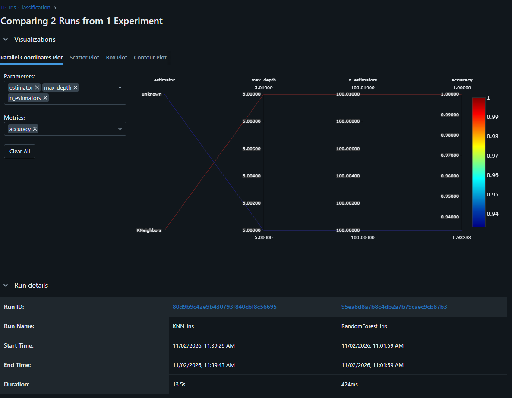
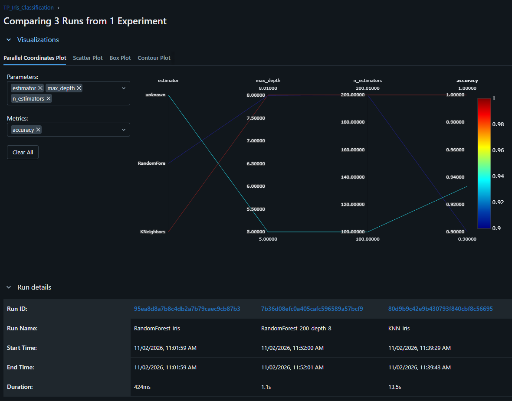
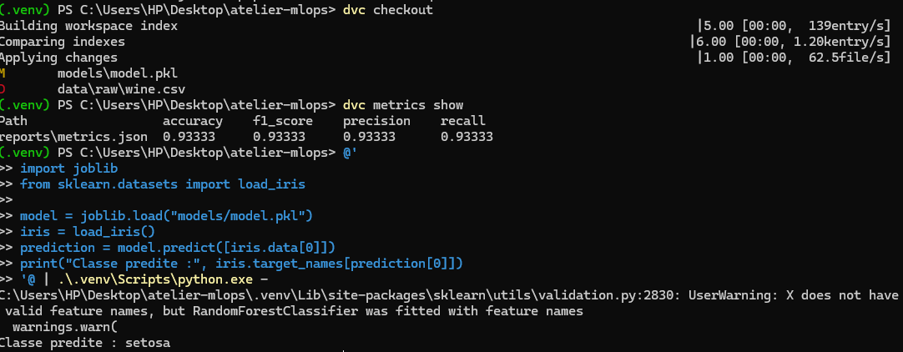
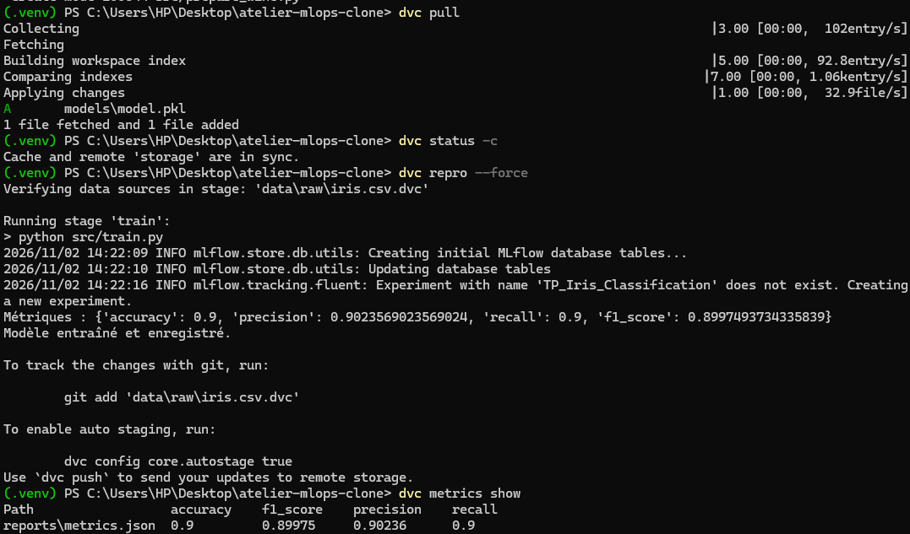

# Rapport — Atelier Git + DVC + MLflow

**Projet :** classification du dataset Iris avec RandomForest et KNN  
**Dépôt GitHub :** https://github.com/tahalrh/atelier-mlops

---

## 1. Objectif

Ce TP montre comment construire un projet Machine Learning versionné et reproductible avec :

- **Git** pour versionner le code ;
- **DVC** pour versionner les données et le pipeline ;
- **MLflow** pour suivre les expériences et comparer les modèles.

---

## 2. Ce qui a été réalisé

- Git : branches `main` et `develop`, tags `v1.0` et `v2.0`, dépôt publié sur GitHub.
- DVC : datasets Iris et Wine versionnés, remote local configuré, pipeline `train` exécuté.
- MLflow : plusieurs runs enregistrés avec paramètres, métriques et modèles.
- Restauration : retour au tag `v1.0` avec `git checkout` puis `dvc checkout`.
- Reproduction : clone du dépôt, `dvc pull`, `dvc repro --force` et vérification des métriques.

---

## 3. Comparaison RandomForest et KNN



**Description :** comparaison de deux runs MLflow. KNN obtient une accuracy de **1,0**, contre **0,9333** pour le RandomForest baseline.

---

## 4. Comparaison des trois expériences



**Description :** comparaison de trois runs :

- RandomForest 100 arbres / profondeur 5 : **0,9333**
- RandomForest 200 arbres / profondeur 8 : **0,9**
- KNN avec 5 voisins : **1,0**

Ce résultat montre qu’augmenter le nombre d’arbres et la profondeur ne garantit pas une meilleure accuracy.

---

## 5. Restauration de la version v1.0



**Description :** retour au tag `v1.0` avec `git checkout v1.0` puis `dvc checkout`. Les métriques restaurées sont celles de la version baseline :

```text
accuracy = 0.93333
```

Le modèle rechargé prédit correctement la classe `setosa`.

---

## 6. Reproduction dans un clone



**Description :** le projet a été cloné dans un autre dossier. Les données ont été récupérées avec `dvc pull`, puis le pipeline a été relancé avec `dvc repro --force`.

Les métriques retrouvées sont :

```text
accuracy = 0.9
f1_score = 0.89975
```

Cela montre que le projet est reproductible.

---

## 7. Résultats

| Modèle | Paramètres | Accuracy | F1-score |
|---|---|---:|---:|
| RandomForest | 100 arbres, profondeur 5 | 0,9333 | 0,9333 |
| RandomForest | 200 arbres, profondeur 8 | 0,9 | 0,89975 |
| KNN | 5 voisins | 1,0 | 1,0 |

---

## 8. Conclusion

Git permet de versionner le code, DVC permet de versionner les données et le pipeline, et MLflow permet de suivre et comparer les expériences.

La restauration d’une ancienne version et la reproduction du projet dans un clone fonctionnent correctement. Le pipeline est donc traçable, versionné et reproductible.
